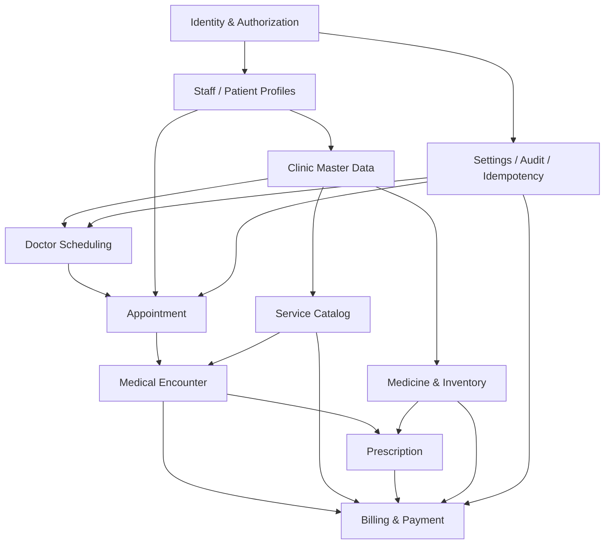
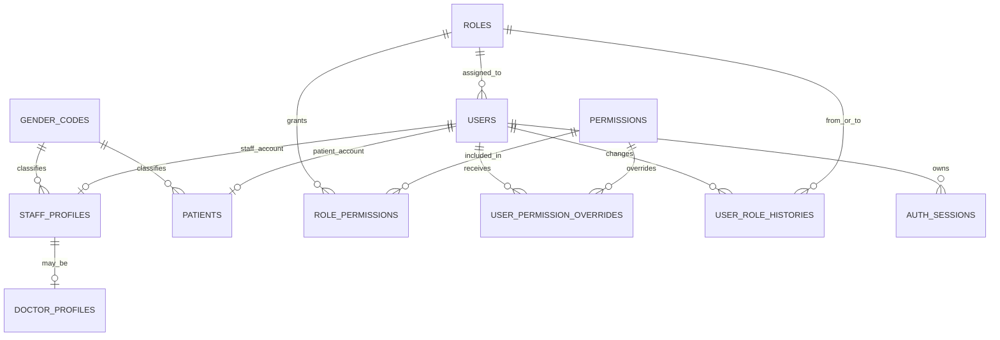
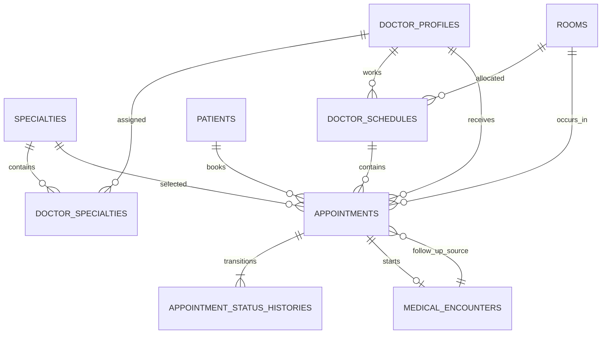
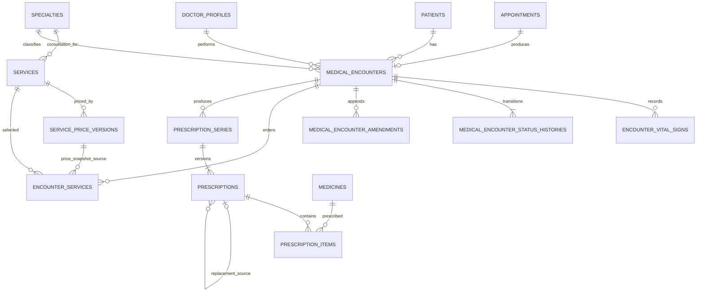
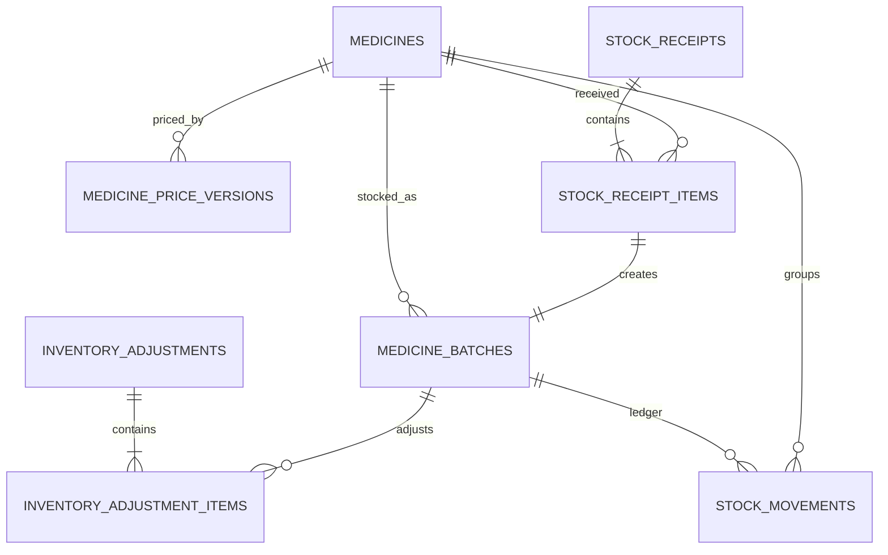
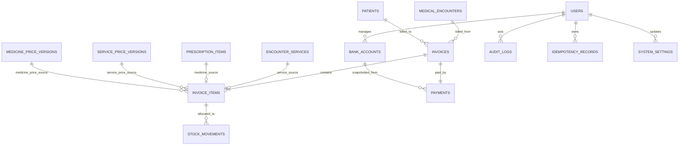

# ERD — DNCS MVP

## 1. Phạm vi và ký hiệu

ERD này mô tả 42 bảng của baseline `MVP-BL-01`. Quan hệ polymorphic được vẽ nét logic trong phần ghi chú vì PostgreSQL không thể tạo một foreign key trỏ tới nhiều bảng.

- `||`: đúng một.
- `o|`: không hoặc một.
- `o{`: không hoặc nhiều.
- `|{`: một hoặc nhiều.

## 2. Bản đồ phụ thuộc tổng thể

## 3. Identity, authorization và profile

Ràng buộc “user STAFF phải có staff profile, user PATIENT phải có patient” là invariant aggregate và được bảo vệ trong transaction tạo/archive/restore; FK đơn lẻ chỉ bảo vệ chiều profile → user.

## 4. Clinic master, scheduling và appointment

Hai vòng tham chiếu appointment–encounter có semantics khác nhau:

- `medical_encounters.appointment_id` là quan hệ nguồn `1 : 0..1` và có unique.
- `appointments.follow_up_from_encounter_id` chỉ dùng khi `source = FOLLOW_UP`; lịch terminal được giữ lịch sử nên một encounter có thể có nhiều follow-up lịch sử nhưng tối đa một lịch đang giữ chỗ.

## 5. Clinical, service và prescription

`prescription_series.current_issued_prescription_id` tạo vòng tham chiếu với `prescriptions.series_id`. Composite FK `(current_issued_prescription_id, id) → prescriptions(id, series_id)` bảo đảm current version thuộc đúng series.

## 6. Medicine và inventory

`stock_movements.reference_type/reference_id` trỏ logic tới một trong `stock_receipt_items`, `inventory_adjustment_items` hoặc `invoice_items`. Không tạo polymorphic FK; command tương ứng là writer duy nhất.

## 7. Billing, payment và platform

`audit_logs.target_type/target_id`, `idempotency_records.resource_type/resource_id` và stock movement source là logical reference. Những cặp này dùng allowlist, command guard và audit/test thay cho generic FK.

## 8. Cardinality/invariant quan trọng

| Quan hệ | Cardinality/Invariant |
| --- | --- |
| User → role | Mỗi user đúng một role hiện hành |
| User → staff/patient | Tối đa một profile; loại profile phải khớp `account_type` |
| Staff → doctor | Tối đa một doctor identity trong toàn vòng đời |
| Doctor ↔ specialty | N:M; tối đa một relation active cho mỗi cặp |
| Doctor/room → active schedule | Không có hai range chồng lấn |
| Doctor/patient/room → holding appointment | Không có hai range chồng lấn |
| Appointment → encounter | Tối đa một encounter |
| Encounter → vital signs | Draft có 0..N; finalized có ít nhất một |
| Specialty → active consultation service | Tối đa một |
| Encounter → active service | Tối đa một row cho mỗi service |
| Series → prescription version | Tối đa một DRAFT và một ISSUED |
| Prescription → active medicine item | Tối đa một row cho mỗi medicine |
| Medicine → batch | Lot number duy nhất trong medicine |
| Encounter → unpaid invoice | Tối đa một; PAID history có thể nhiều |
| Source service/prescription item → invoice item | Tối đa một trên toàn lịch sử |
| Invoice → payment | Đúng một, được tạo cùng transaction |
| Invoice medicine item → stock movement | 0..N allocation batch; sau confirm phải đủ tổng quantity |

